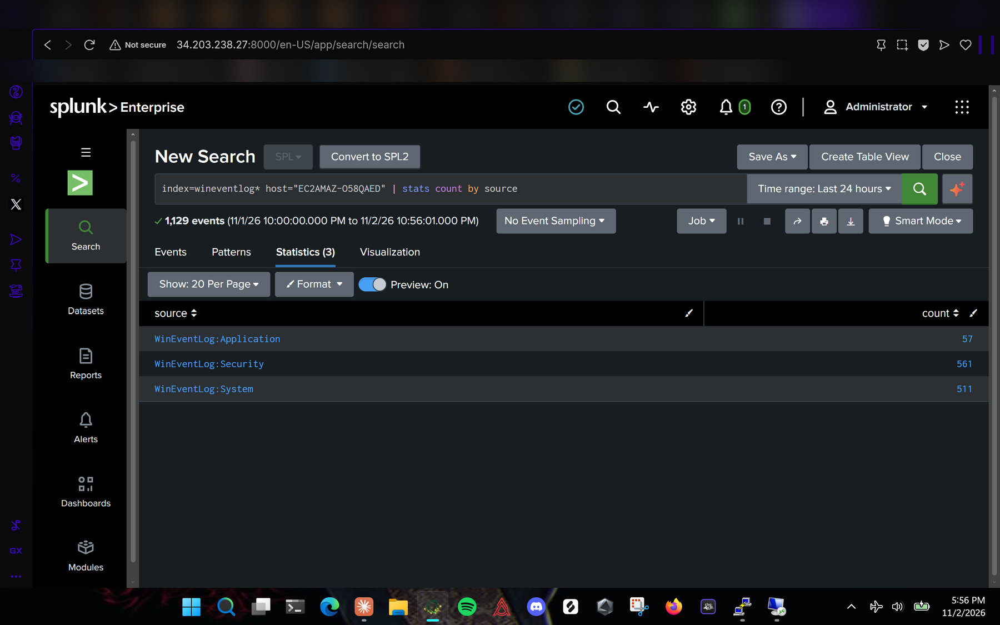
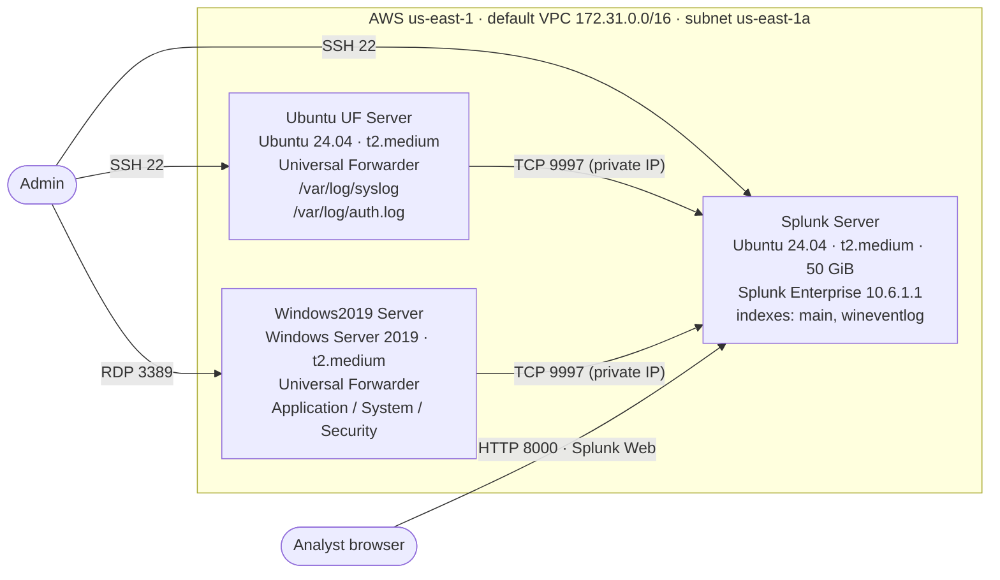
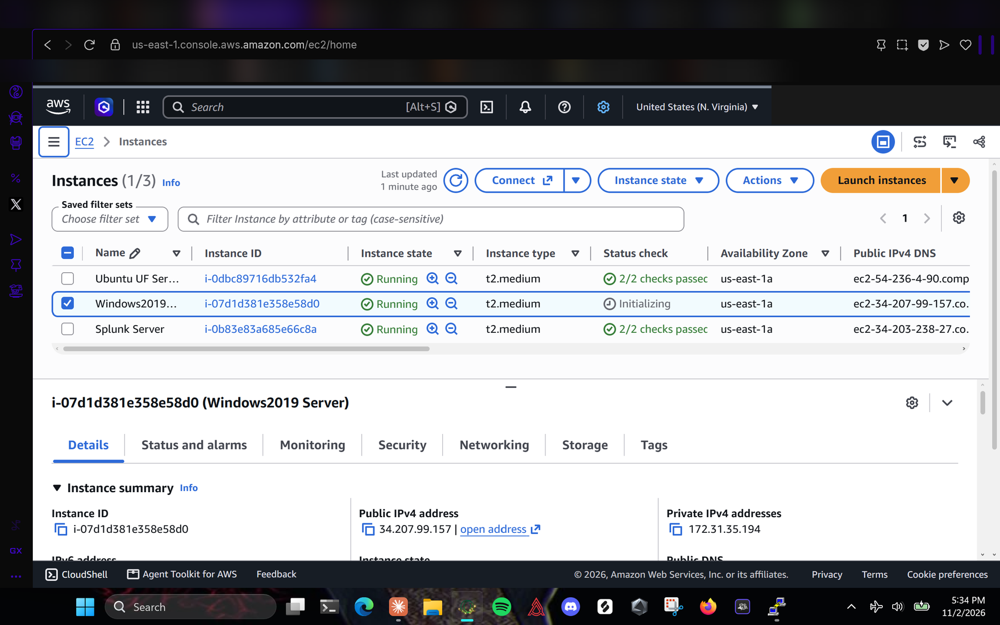
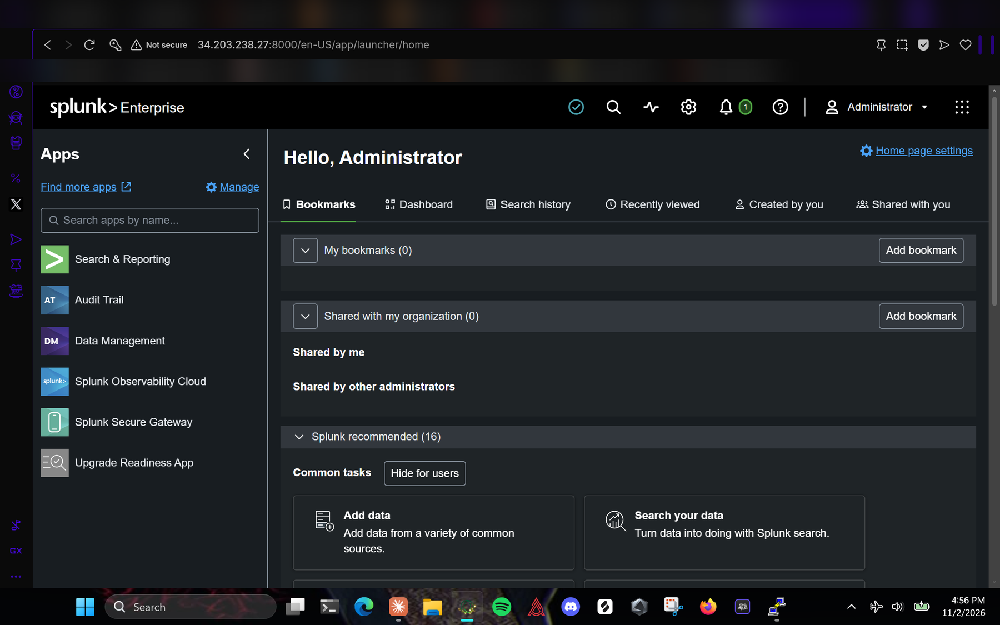
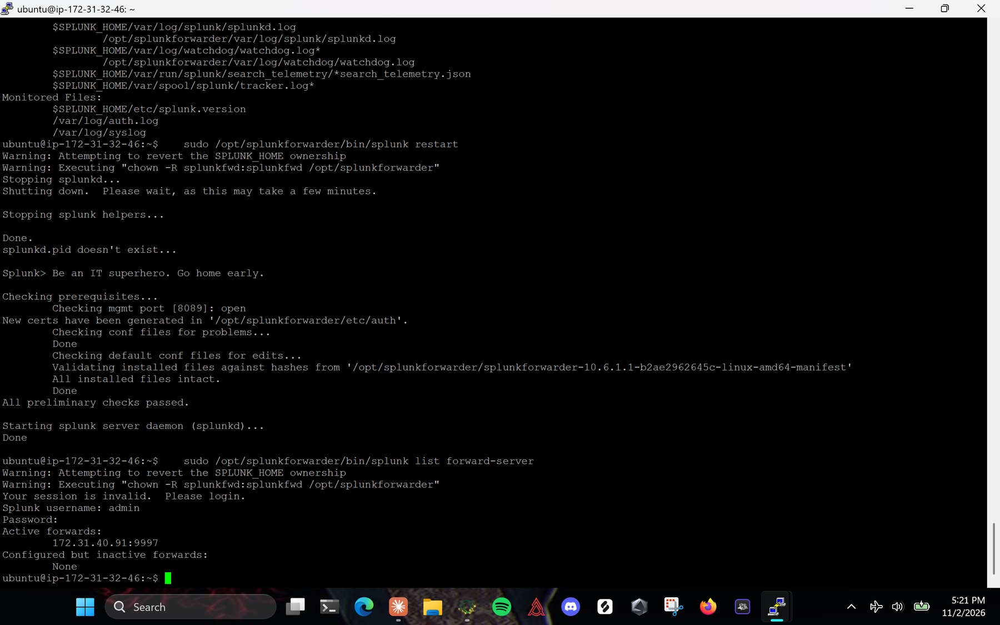
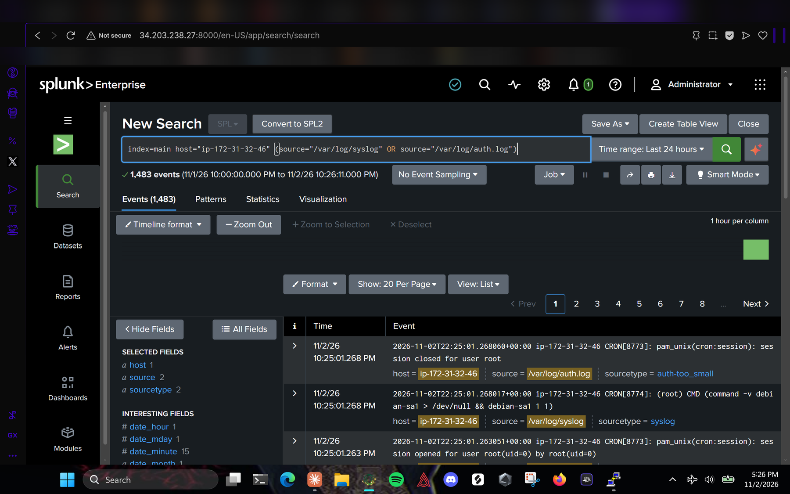
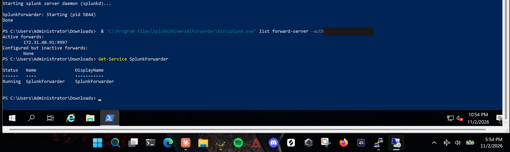
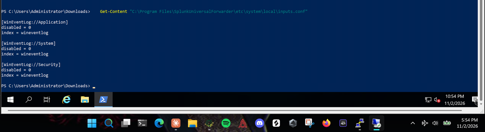
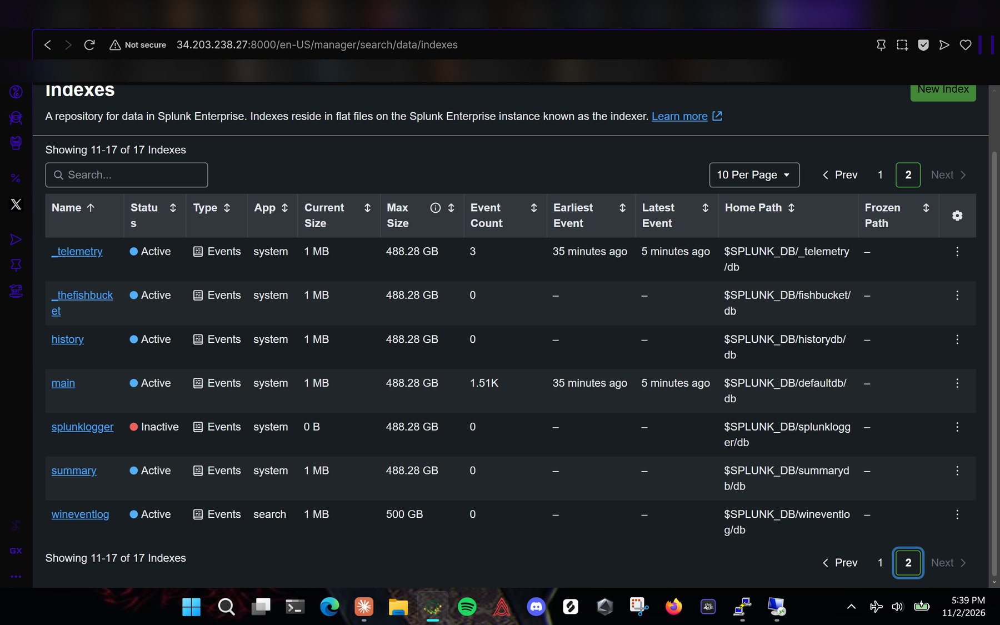
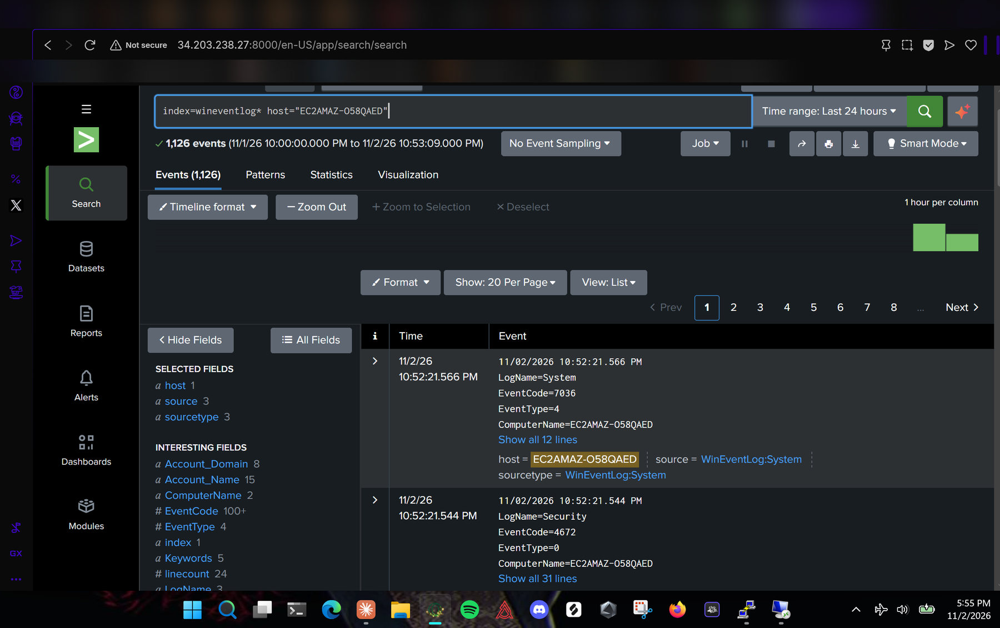

# AWS Splunk SIEM Lab

Centralized log collection on AWS: a Splunk Enterprise server on EC2 that receives Linux and Windows logs from Splunk Universal Forwarders running on two other EC2 instances.

I built this in the AWS Academy Learner Lab as a project for my Cybersecurity A.A.S. at Northern Virginia Community College. It covers the basic plumbing behind a SOC's SIEM: deploying servers, opening only the ports each one needs, installing forwarders, and confirming the logs actually arrive and can be searched.



## Architecture



The forwarders send to the Splunk Server's **private** IP. That keeps log traffic inside the VPC, lets port 9997 stay closed to the internet, and means nothing breaks when the Learner Lab restarts and hands out new public IPs.

## Environment

| Instance | OS / AMI | Type | AZ | Private IP | Inbound rules |
|---|---|---|---|---|---|
| Splunk Server | Ubuntu Server 24.04 LTS | t2.medium | us-east-1a | 172.31.40.91 | 22 (SSH), 8000 (Splunk Web), 9997 from 172.31.0.0/16 only |
| Ubuntu UF Server | Ubuntu Server 24.04 LTS | t2.medium | us-east-1a | 172.31.32.46 | 22 (SSH) |
| Windows2019 Server | Windows Server 2019 Base | t2.medium | us-east-1a | 172.31.35.194 | 3389 (RDP) |

- Key pair: `vockey` (Learner Lab default)
- Splunk Enterprise and Universal Forwarder version: **10.6.1.1**
- Splunk Server storage: 50 GiB gp3; the other two use default storage
- The forwarders need no inbound rules for logging, because they open the connection outbound to 9997

## Results

| Source | Host in Splunk | Index | Events (first 24 h) |
|---|---|---|---|
| `/var/log/syslog` + `/var/log/auth.log` | `ip-172-31-32-46` | `main` | 1,483 |
| `WinEventLog:Application` | `EC2AMAZ-O58QAED` | `wineventlog` | 57 |
| `WinEventLog:Security` | `EC2AMAZ-O58QAED` | `wineventlog` | 561 |
| `WinEventLog:System` | `EC2AMAZ-O58QAED` | `wineventlog` | 511 |

## How it was built

Each step has a full walkthrough in [`docs/`](docs/) and a script in [`scripts/`](scripts/).

1. **Splunk Server** ([docs/01-splunk-server.md](docs/01-splunk-server.md)): launched the EC2 instance, connected with PuTTY, installed Splunk Enterprise, enabled boot-start, turned on receiving on 9997, and created the `wineventlog` index.
2. **Linux forwarder** ([docs/02-linux-forwarder.md](docs/02-linux-forwarder.md)): installed the Universal Forwarder, pointed it at `172.31.40.91:9997`, and monitored `syslog` and `auth.log`.
3. **Windows forwarder** ([docs/03-windows-forwarder.md](docs/03-windows-forwarder.md)): connected over RDP, installed the forwarder silently with `msiexec`, and collected the Application, System and Security event logs into `wineventlog`.

Configuration files are in [`configs/`](configs/), and the searches I used to check the data are in [`searches/splunk-searches.md`](searches/splunk-searches.md).

## Screenshots

| | |
|---|---|
|  **All three instances** running as t2.medium in us-east-1a |  **Splunk Web** on port 8000 |
|  **Linux UF** monitoring syslog and auth.log, active forward to 9997 |  **Linux events** searchable in Splunk |
|  **Windows UF** connected, service running |  **Windows inputs.conf** for the three event logs |
|  **`wineventlog` index** created on the server |  **Windows events** from `EC2AMAZ-O58QAED` |

The rest are in [`screenshots/`](screenshots/). The AWS account ID, my lab user name, passwords and my browser bookmarks are redacted. The public IPs that appear were temporary Learner Lab addresses and are no longer assigned to these instances.

## Problems I ran into

Full notes are in [docs/troubleshooting.md](docs/troubleshooting.md).

- **First instances were the wrong size.** My earlier t3.micro had 1 GB of RAM, which isn't enough for Splunk Enterprise, and the instances were in the wrong Availability Zone. AZ can't be changed after launch, so I rebuilt all three to spec.
- **An "All TCP from anywhere" rule crept into the launch wizard.** I caught it before launch and replaced it with SSH only.
- **Downloaded the wrong package.** I grabbed the 1.3 GB Splunk Enterprise `.deb` on the forwarder host instead of the Universal Forwarder, deleted it, and pulled the correct package.
- **The forwarder couldn't read Ubuntu's logs.** The UF runs as `splunkfwd`, and `/var/log/syslog` and `auth.log` are only readable by the `adm` group. Fix: `sudo usermod -aG adm splunkfwd`, then restart.
- **Windows events need a destination index.** If a forwarder sends to an index that doesn't exist, the indexer drops the data, so I created `wineventlog` on the server before installing the Windows forwarder.
- **Multi-line PowerShell pastes broke over RDP.** The download command arrived split in two. I re-ran the commands one line at a time and rewrote the config step as single-line commands.
- **Timestamps looked 5 hours off.** The EC2 servers run on UTC and my screenshots are in Eastern time.

## What I'd change for production

This is a lab. In a real environment I would:

- Restrict SSH, RDP and Splunk Web to an admin IP range or a VPN, or drop SSH/RDP entirely in favor of AWS Systems Manager Session Manager
- Turn on TLS between the forwarders and the indexer, and HTTPS for Splunk Web
- Manage forwarder configs centrally with a Splunk deployment server instead of editing each host
- Keep credentials out of command lines (`-auth admin:...` shows up in shell history and process lists) and store them in a secrets manager
- Install the Splunk Add-on for Unix and Linux and the Splunk Add-on for Windows so fields extract cleanly
- Add retention settings and alerts, such as repeated failed logons (Windows Event ID 4625) or `sudo` failures in `auth.log`

## Skills demonstrated

AWS EC2 · security groups · VPC networking · Linux administration (Ubuntu 24.04, systemd, permissions) · Windows Server administration (RDP, PowerShell, msiexec) · Splunk Enterprise · Splunk Universal Forwarder · SPL searching · log collection for SIEM and SOC work

## Repository layout

```
aws-splunk-siem-lab/
├── README.md
├── configs/
│   ├── splunk-server/   inputs.conf (receiving on 9997), indexes.conf (wineventlog)
│   ├── linux-uf/        outputs.conf, inputs.conf
│   └── windows-uf/      outputs.conf, inputs.conf
├── docs/
│   ├── 01-splunk-server.md
│   ├── 02-linux-forwarder.md
│   ├── 03-windows-forwarder.md
│   ├── demo-guide.md
│   └── troubleshooting.md
├── scripts/
│   ├── install-splunk-server.sh
│   ├── install-linux-uf.sh
│   └── install-windows-uf.ps1
├── searches/
│   └── splunk-searches.md
└── screenshots/
```

## Author

**Ifayet** · [github.com/Ifa89](https://github.com/Ifa89) · Cybersecurity A.A.S., Northern Virginia Community College
