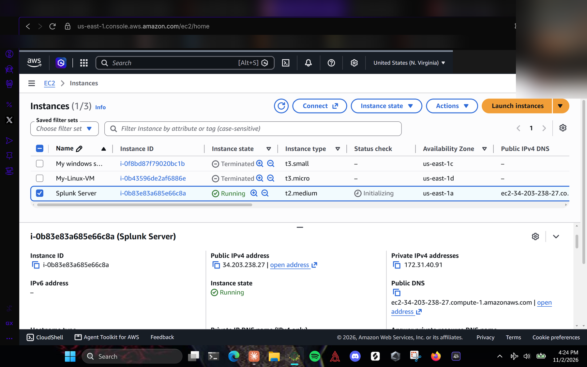
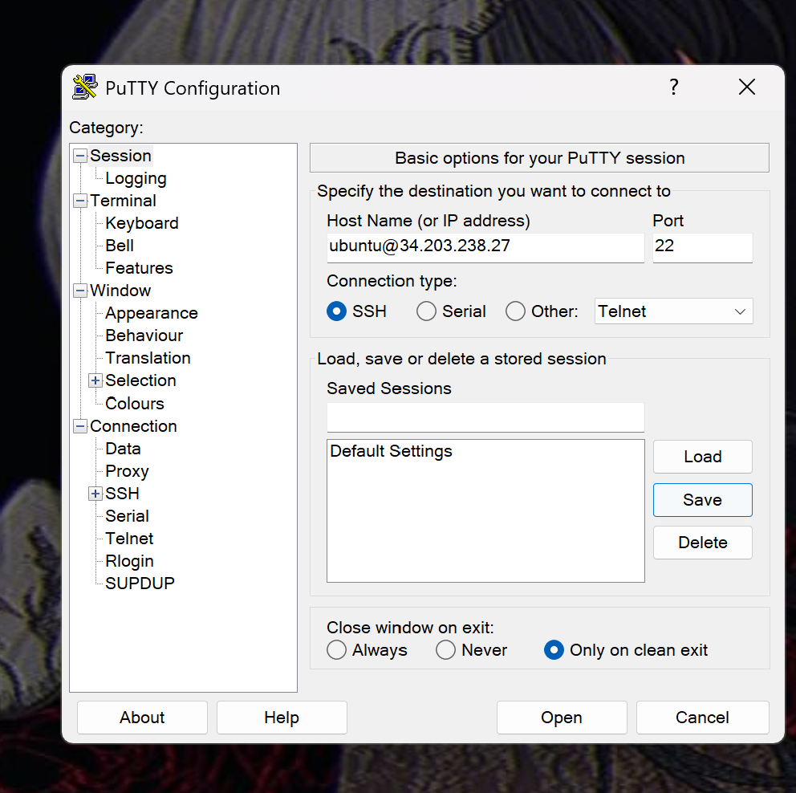
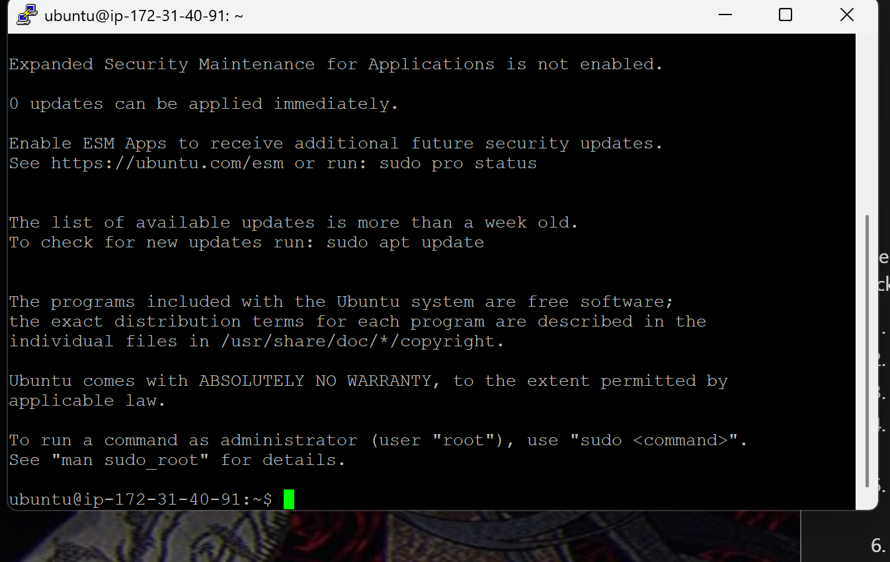
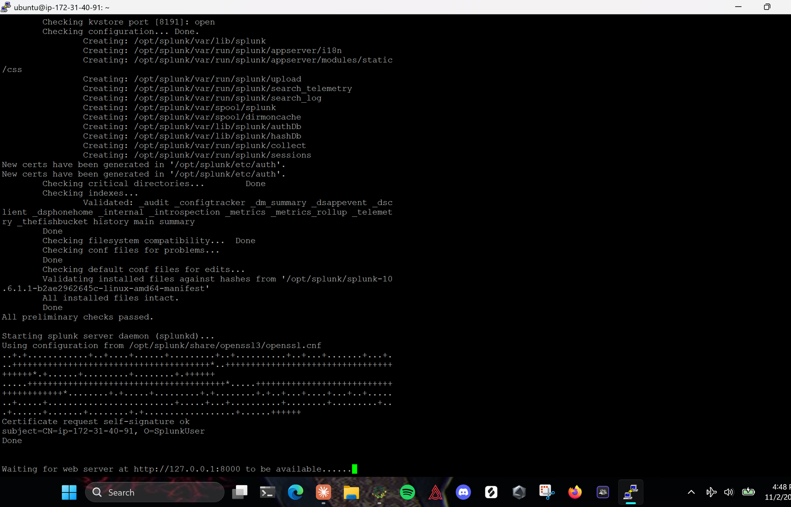
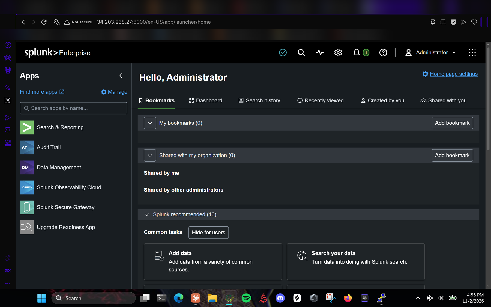
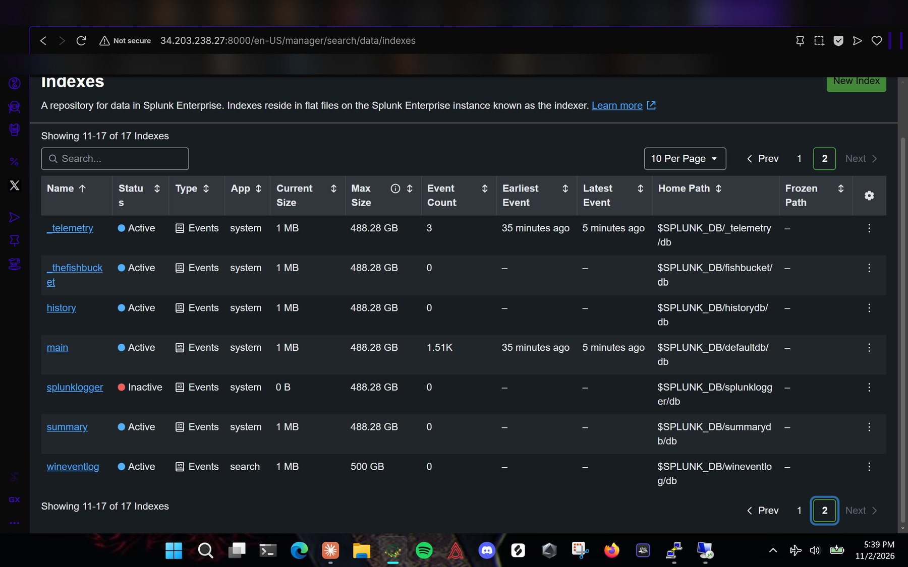

# 1. Splunk Server (Ubuntu 24.04, Splunk Enterprise)

Script version: [`scripts/install-splunk-server.sh`](../scripts/install-splunk-server.sh)

## Launch the instance

In **EC2 > Launch instances**:

1. **Name:** `Splunk Server`
2. **AMI:** Ubuntu Server 24.04 LTS (HVM), SSD Volume Type, 64-bit (x86)
3. **Instance type:** `t2.medium` (2 vCPU, 4 GiB). Splunk Enterprise does not run well on 1 GB instances like t3.micro.
4. **Key pair:** `vockey`
5. **Network settings > Edit:**
   - Subnet: the one in **us-east-1a**
   - Auto-assign public IP: Enable
   - New security group `splunk-server-sg`:

     | Type | Port | Source | Purpose |
     |---|---|---|---|
     | SSH | 22 | 0.0.0.0/0 (lab) | Admin access with PuTTY |
     | Custom TCP | 8000 | 0.0.0.0/0 (lab) | Splunk Web |
     | Custom TCP | 9997 | 172.31.0.0/16 | Forwarders, VPC only |

   The wizard sometimes pre-fills an **All TCP 0-65535** rule. Change it to SSH before launching.
6. **Storage:** 50 GiB gp3
7. Launch, wait for **2/2 checks passed**, and note the public and private IPs.



## Connect with PuTTY

1. Learner Lab page > **AWS Details > Download PPK** (`labsuser.ppk`). Keep this file private.
2. PuTTY **Session > Host Name:** `ubuntu@<public-IP>`, port 22.
3. **Connection > SSH > Auth > Credentials:** browse to `labsuser.ppk`.
4. Save the session, click **Open**, accept the host key.




## Install Splunk Enterprise

```bash
sudo apt update && sudo apt upgrade -y

# Copy the current link from splunk.com: Splunk Enterprise > Linux > .deb > Copy wget link
wget -O splunk-10.6.1.1-b2ae2962645c-linux-amd64.deb \
  "https://download.splunk.com/products/splunk/releases/10.6.1.1/linux/splunk-10.6.1.1-b2ae2962645c-linux-amd64.deb"

sudo dpkg -i splunk-10.6.1.1-*.deb
```

The installer prints `find: '/opt/splunk/lib/python3.7/site-packages': No such file or directory`. That is a harmless cleanup message on a fresh install.

## First start, boot-start and receiving

```bash
# Prompts for the admin username and password
sudo -u splunk /opt/splunk/bin/splunk start --accept-license

# Run under systemd so Splunk comes back after a lab restart
sudo -u splunk /opt/splunk/bin/splunk stop
sudo /opt/splunk/bin/splunk enable boot-start -user splunk -systemd-managed 1
sudo systemctl start Splunkd
sudo systemctl status Splunkd --no-pager

# Accept forwarder traffic
sudo -u splunk /opt/splunk/bin/splunk enable listen 9997 -auth admin:<password>
```



## Log in to Splunk Web

Open `http://<public-IP>:8000` (http, not https) and sign in as the admin user.



## Create the `wineventlog` index

**Settings > Indexes > New Index**, name `wineventlog`, Save. Do this before the Windows forwarder is installed, because an indexer drops events addressed to an index that doesn't exist.


