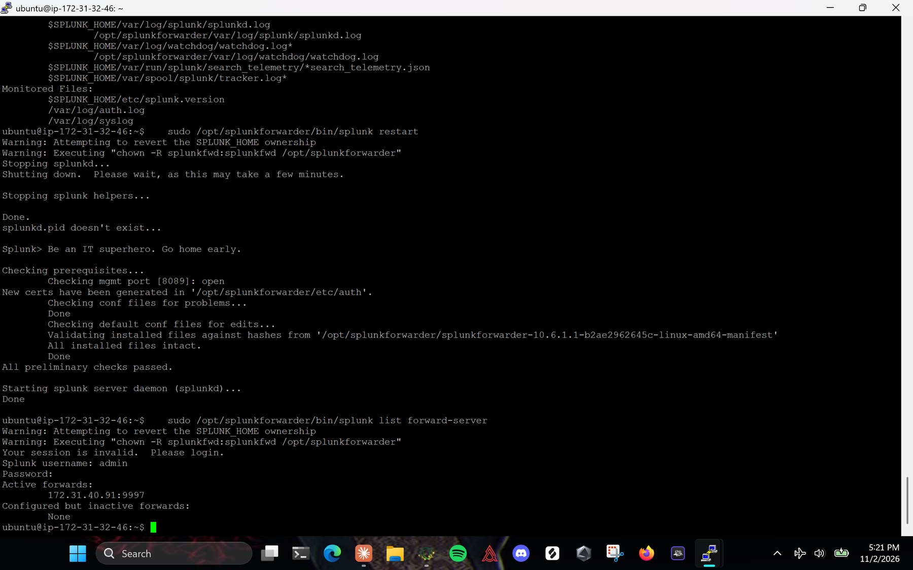
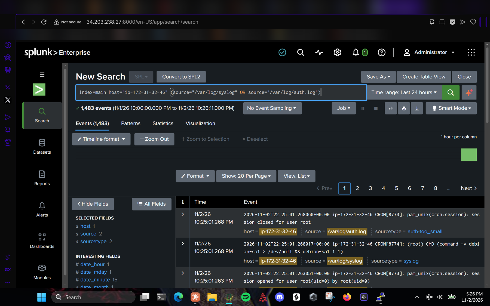

# 2. Linux Universal Forwarder (Ubuntu UF Server)

Script version: [`scripts/install-linux-uf.sh`](../scripts/install-linux-uf.sh)

## Launch the instance

Same as the Splunk Server except:

- **Name:** `Ubuntu UF Server`
- **Security group** `ubuntu-uf-sg`: SSH (22) only. The forwarder connects outbound to 9997, and outbound traffic is allowed by default.
- **Storage:** default (8 GiB)

## Install the forwarder

Connect with PuTTY as `ubuntu@<UF public IP>`, then:

```bash
sudo apt update && sudo apt upgrade -y

# splunk.com: Universal Forwarder > Linux > .deb (64-bit x86) > Copy wget link
# Check that the URL says "universalforwarder"; the Enterprise package is 1.3 GB and the wrong one here.
wget -O splunkforwarder-10.6.1.1-b2ae2962645c-linux-amd64.deb \
  "https://download.splunk.com/products/universalforwarder/releases/10.6.1.1/linux/splunkforwarder-10.6.1.1-b2ae2962645c-linux-amd64.deb"

sudo dpkg -i splunkforwarder-*.deb
sudo /opt/splunkforwarder/bin/splunk start --accept-license   # create the forwarder admin login
```

The first start reports `splunk will start under systemd as user: splunkfwd`.

## Let the forwarder read the logs

On Ubuntu, `/var/log/syslog` and `/var/log/auth.log` are owned by `syslog:adm` with mode 640. Without this step the forwarder connects but sends no log data:

```bash
sudo usermod -aG adm splunkfwd
```

## Point it at the server and add the logs

```bash
sudo /opt/splunkforwarder/bin/splunk add forward-server 172.31.40.91:9997   # Splunk Server PRIVATE IP
sudo /opt/splunkforwarder/bin/splunk add monitor /var/log/syslog
sudo /opt/splunkforwarder/bin/splunk add monitor /var/log/auth.log
sudo /opt/splunkforwarder/bin/splunk list monitor
sudo /opt/splunkforwarder/bin/splunk restart
sudo /opt/splunkforwarder/bin/splunk list forward-server
```

`list forward-server` should show `172.31.40.91:9997` under **Active forwards**. The "Attempting to revert the SPLUNK_HOME ownership" warnings are normal when running Splunk commands with sudo.



## Verify in Splunk

Search & Reporting, time range **Last 24 hours**:

```spl
index=main host="ip-172-31-32-46" (source="/var/log/syslog" OR source="/var/log/auth.log")
```

Result: 1,483 events, with both files under the `source` field.


