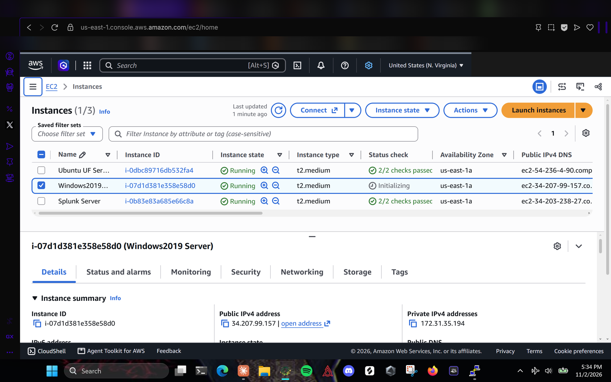
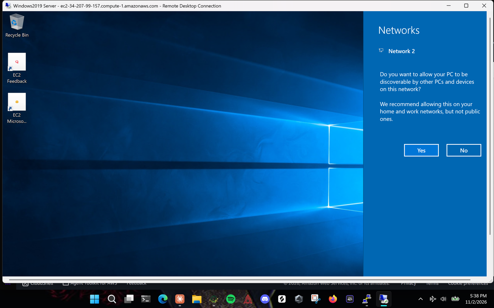
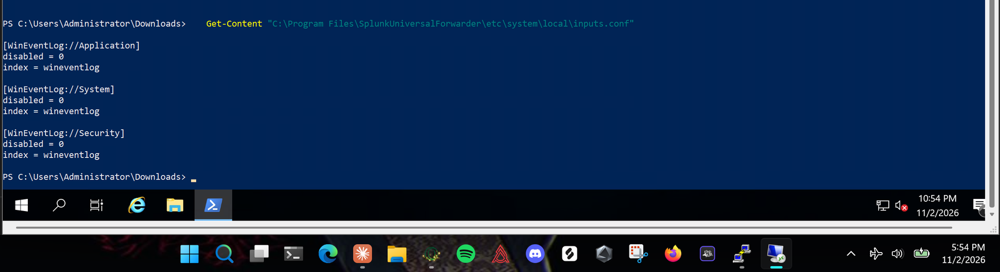
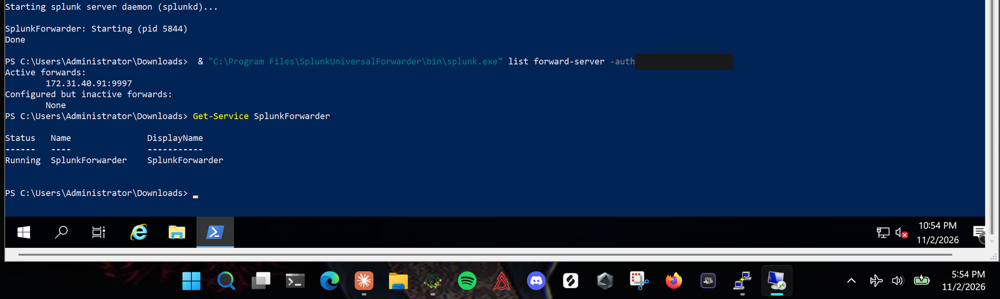
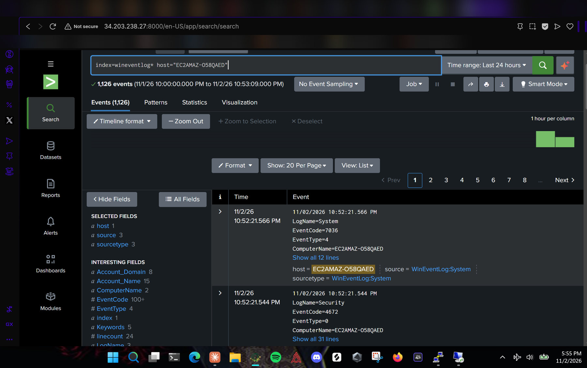
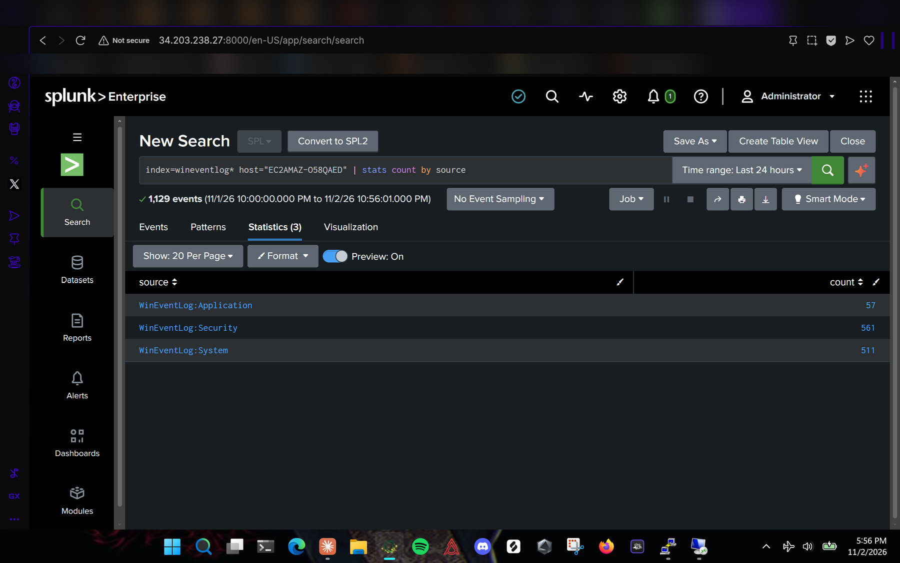

# 3. Windows Universal Forwarder (Windows2019 Server)

Script version: [`scripts/install-windows-uf.ps1`](../scripts/install-windows-uf.ps1)

## Launch the instance

- **Name:** `Windows2019 Server`
- **AMI:** Microsoft Windows Server 2019 Base. The console usually defaults to a newer version; search `2019` to find it.
- **Type:** `t2.medium`, **Key pair:** `vockey`, **Subnet:** us-east-1a
- **Security group** `windows-uf-sg`: RDP (3389) only
- **Storage:** default (30 GiB)



## Connect with RDP

1. Wait about 4 to 5 minutes after launch, until **2/2 checks passed**.
2. Learner Lab > **AWS Details > Download PEM**.
3. EC2 > select the instance > **Connect > RDP client > Get password**, upload the `.pem`, **Decrypt password**.
4. **Download remote desktop file**, open it, sign in as `Administrator`.
5. Answer **No** to the network discovery prompt.



## Install the forwarder

Open **Windows PowerShell** (the 64-bit one, not "x86"). Paste **one line at a time**: multi-line pastes over RDP can arrive split and fail.

```powershell
$ProgressPreference = 'SilentlyContinue'
cd $env:USERPROFILE\Downloads
$url = "https://download.splunk.com/products/universalforwarder/releases/10.6.1.1/windows/splunkforwarder-10.6.1.1-b2ae2962645c-windows-x64.msi"
Invoke-WebRequest -Uri $url -OutFile splunkforwarder.msi
dir splunkforwarder.msi
```

Install silently. `USE_LOCAL_SYSTEM=1` runs the service as Local System, which can read the Security log. Use a letters-and-numbers password.

```powershell
Start-Process msiexec.exe -Wait -ArgumentList '/i splunkforwarder.msi AGREETOLICENSE=Yes RECEIVING_INDEXER="172.31.40.91:9997" SPLUNKUSERNAME=admin SPLUNKPASSWORD=<password> USE_LOCAL_SYSTEM=1 LAUNCHSPLUNK=1 /quiet'
```

## Collect Application, System and Security

```powershell
$conf = "`r`n[WinEventLog://Application]`r`ndisabled = 0`r`nindex = wineventlog`r`n`r`n[WinEventLog://System]`r`ndisabled = 0`r`nindex = wineventlog`r`n`r`n[WinEventLog://Security]`r`ndisabled = 0`r`nindex = wineventlog`r`n"
Add-Content -Path "C:\Program Files\SplunkUniversalForwarder\etc\system\local\inputs.conf" -Value $conf -Encoding Ascii
Get-Content "C:\Program Files\SplunkUniversalForwarder\etc\system\local\inputs.conf"
& "C:\Program Files\SplunkUniversalForwarder\bin\splunk.exe" restart
```



## Check the forwarder

```powershell
& "C:\Program Files\SplunkUniversalForwarder\bin\splunk.exe" list forward-server -auth admin:<password>
Get-Service SplunkForwarder
```

Expected: `172.31.40.91:9997` under **Active forwards**, and the service **Running**. The server clock shows UTC, five hours ahead of Eastern time.



## Verify in Splunk

```spl
index=wineventlog* host="EC2AMAZ-O58QAED"
```



```spl
index=wineventlog* host="EC2AMAZ-O58QAED" | stats count by source
```

| source | count |
|---|---|
| WinEventLog:Application | 57 |
| WinEventLog:Security | 561 |
| WinEventLog:System | 511 |


